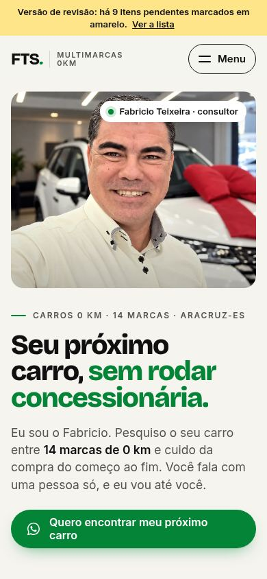
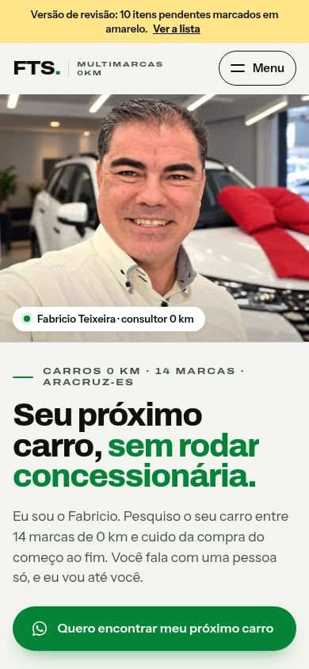
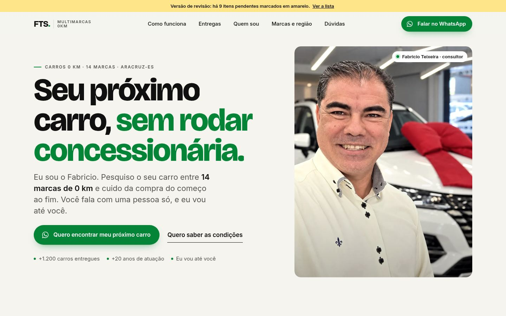
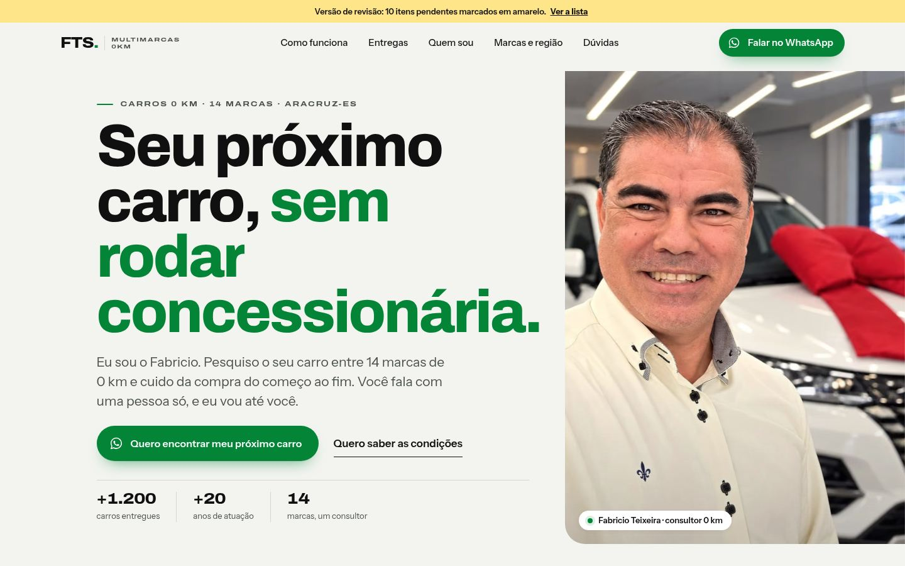

# Redesign v2 do site da FTS Multimarcas 0km

Modo **EVOLUIR**: mesma estrutura de conteúdo, mesmas mensagens de WhatsApp e mesmos dados confirmados da v1, com nova direção de arte, novo código e desempenho melhor. Nenhum dado novo foi criado: tudo o que aparece veio do Fabricio ou do registro público da empresa; o que falta continua marcado como pendência.

- Código: `fts-multimarcas/` (Astro). Como rodar, editar e publicar: [`../../README.md`](../../README.md).
- v1 para comparação: commit `ab70ee6` (`fts-multimarcas/index.html`).

## 1. Diagnóstico da v1

| # | Problema | Evidência |
|---|---|---|
| 1 | Topo em dois blocos com cara de "card", espaço morto e foto pequena para o que é o maior ativo do site (o próprio Fabricio). | `antes/1440-topo.jpg` |
| 2 | Tipografia genérica (Bricolage Grotesque + Inter), sem contraste de largura nem de peso; os títulos não têm voz. | Todas as seções |
| 3 | Números estáticos e todos do mesmo tamanho: "+1.200 carros entregues" não se destaca. | Faixa preta logo após o topo |
| 4 | Cartões de "O que você procura?" só com texto, parecendo espaço reservado. | `antes/390-pagina.jpg` |
| 5 | Assinatura 14 → 1 pesada à esquerda e, no celular, com rotas que cruzavam os logos. | Seção "O diferencial" |
| 6 | "Como funciona" como 4 passos genéricos, sem ligação visual com o resto. | Seção 5 |
| 7 | Galeria com alturas irregulares e contador do filtro ativo com contraste 3,55:1 (abaixo do AA). | axe: 1 violação séria |
| 8 | Vídeos acrescentados no fim, sem hierarquia entre o depoimento longo e os curtos. | Seção Entregas |
| 9 | Parede de logos apertada e nomes das cidades em tipografia enorme disputando com as marcas. | Seção Marcas e região |
| 10 | Fontes do Google bloqueando a renderização (~2,1 s), LCP 3,2 s, Speed Index 5,0 s no celular, e ritmo previsível (papel, preto, papel, preto). | Lighthouse v1 |

## 2. Direção de arte: "Entrega em mãos"

O site é a viagem do primeiro "oi" até a chave na mão, com o Fabricio dirigindo.
**Rotas**: as 14 marcas viram 14 caminhos que se juntam nele; "Como funciona" é uma estrada com 4 paradas; a região são placas verdes de destino.
**Hodômetro**: os números rodam como um painel de carro, sem arredondar o que não foi informado.
**Asfalto e showroom**: seções escuras com grão sutil (asfalto) alternam com o piso claro de showroom.
**Laço vermelho**: só aparece nas fotos reais de entrega, nunca como enfeite.
**Letra com largura variável**: Archivo larga (125%) nos rótulos, como emblemas de carro; estreita (86%) nas placas; normal nos títulos. Instrument Sans para leitura.
**Verde #048437 só para ação e rota**: tudo que é verde leva ao WhatsApp ou mostra o caminho.

## 3. Tokens

Definidos em `src/styles/global.css`.

**Cores e contraste (WCAG 2.1)**

| Token | Valor | Uso | Contraste |
|---|---|---|---|
| `--verde` | #048437 | botões, rota, destaques | branco sobre verde 4,82:1 (AA) |
| `--verde-600` | #036C2D | hover, texto verde pequeno | 5,97:1 sobre o piso; branco sobre ele 6,59:1 |
| `--verde-400` | #3FB26A | verde sobre fundo escuro | 7,06:1 sobre o asfalto |
| `--preto` / `--asfalto` | #101010 | texto e seções escuras | 17,22:1 sobre o piso |
| `--piso` | #F3F4F0 | fundo claro (piso de showroom) | — |
| `--piso-2`, `--linha` | #E8EAE4, #D6D9D1 | superfícies e divisórias | — |
| `--tinta-2` | #4A504B | texto secundário | 7,48:1 sobre o piso |
| `--tinta-3` | #677068 | texto terciário | 4,64:1 sobre o piso |
| `--nevoa` | #A9AFA9 | texto secundário no escuro | 8,51:1 sobre o asfalto |
| `--pend-bg` | #FFE58A | marcações [PENDENTE] da revisão | 15,25:1 com texto preto |

O verde #048437 sobre o piso (4,36:1) só aparece em títulos grandes (AA para texto grande).

**Tipografia**: Archivo Variable (eixos de peso e largura) para títulos e rótulos; Instrument Sans Variable para texto. Escala fluida: topo `clamp(2.55rem, 1.05rem + 5.35vw, 5.9rem)`, h2 `clamp(2.05rem, 1.2rem + 3.3vw, 4.25rem)`, h3 `clamp(1.28rem, 1.05rem + .9vw, 1.75rem)`, lead `clamp(1.06rem, .98rem + .42vw, 1.32rem)`, corpo 17px, rótulos 11,5px em caixa-alta com largura 125%.

**Espaço e grade**: 12 colunas, margem `clamp(16px, 4vw, 56px)`, intervalo `clamp(12px, 1.8vw, 24px)`, largura máxima 1360px, seções `clamp(76px, 9vw, 136px)`.

**Forma**: fotos 22px, cartões 16px, peças pequenas 10px, botões em pílula; sombra "flutuante" `0 18px 40px -22px rgba(16,16,16,.45)`.

**Movimento**: saída `cubic-bezier(.2,.8,.2,1)`, meio `cubic-bezier(.65,0,.35,1)`, mola `cubic-bezier(.34,1.4,.64,1)`; durações .25s / .6s / .95s.

## 4. Decisões de tecnologia

| Necessidade | Escolha | Alternativa avaliada | Por quê |
|---|---|---|---|
| Estrutura | **Astro 7**, site estático | Next.js, SPA em Vite | HTML pronto no build, legível sem JS, 0 KB de JS por padrão, publica em qualquer hospedagem. |
| Galeria (filtro + carrossel + tela cheia) | **Ilha React 19** (`client:visible`) com **Embla Carousel 8** e **yet-another-react-lightbox 3** | Swiper, PhotoSwipe, código próprio | É a única parte com estado compartilhado (filtro ↔ carrossel ↔ tela cheia). Só carrega quando a galeria se aproxima da tela. |
| Animações conduzidas pela rolagem | **Controlador próprio** (`src/scripts/rolagem.ts`, 1,6 KB gz) | GSAP + ScrollTrigger | Foi implementado com GSAP primeiro; ele somava 45 KB gz ao carregamento só para medir "quanto da seção já passou" em duas cenas. Trocado sem mudar o efeito. |
| Micro-animações da galeria | **CSS + Web Animations API** | Motion (framer-motion) | Também testado: 43 KB gz a mais na ilha para a pílula do filtro e a entrada das fotos. |
| Rolagem suave | **Lenis 1.3**, só no desktop com mouse e carregado sob demanda (5,4 KB gz) | só nativa | Sensação mais macia no desktop sem mexer na rolagem por toque. Desligado com "reduzir movimento". |
| Estilos | **CSS com tokens + estilos escopados do Astro** | Tailwind | Sistema pequeno e autoral, controle fino de fonte variável e `clip-path`, sem dependência. |
| Fontes | **Fontsource**, auto-hospedadas, `font-display: swap` + preload da principal | Google Fonts | Na v1 as fontes do Google bloqueavam a renderização por ~2,1 s. |
| Imagens | **astro:assets + sharp**: AVIF e WebP, `srcset`, recorte próprio no celular | arquivos prontos à mão | Uma foto-mestre por imagem; o build gera os tamanhos certos para cada tela. |
| Testes | **Playwright + axe-core** (`npm run qa`) | — | 67 verificações automáticas a cada mudança. |

Orçamentos do pedido: JS inicial ≤ 90 KB gz (resultado: **7 KB**); foto do topo ≤ 150 KB (resultado: **31 KB** no celular, 25–66 KB no desktop).

## 5. Mapa de movimento

| Elemento | Gatilho | Comportamento | Duração / easing | Celular | Reduzir movimento |
|---|---|---|---|---|---|
| Título do topo | Primeira pintura (CSS, não espera o JS) | Palavras sobem de dentro de uma máscara, escalonadas | .9s, saída; 45 ms por palavra | Igual | Aparece direto |
| Foto do topo | Primeira pintura | Abre de baixo para cima (`clip-path`) com zoom 1,1 → 1 | 1s / 1,1s, meio | Igual | Aparece direto |
| Rótulo, texto, botões e prova do topo | Primeira pintura | Sobem 14px com fade, de .15s a .65s | .65s, saída | Igual | Aparecem direto |
| Títulos das seções | 12% dentro da tela | Máscara linha a linha | .85s, saída; 110 ms por linha | Igual | Fade |
| Blocos | 12% dentro da tela | Sobem 26px com fade, escalonados | .8–.9s, saída | Sobem 14px | Fade |
| Hodômetro | Entrar na tela | Cada dígito roda como um rolo; as casas da direita dão mais voltas | 1,9s, saída | Igual | Número final |
| Assinatura 14 → 1 | Rolagem (palco preso por ~2 telas) | Logos entram juntos; as rotas se desenham com um ponto viajando; o retrato cresce; o botão aparece; o texto muda em 3 fases | Proporcional à rolagem, suavizada; logos .6s com mola | Duas colunas e feixe central (em telas baixas, versão parada) | Parada e completa |
| Estrada do "Como funciona" | Rolagem (78% → 55% da tela) | A faixa verde avança e as paradas acendem | Proporcional à rolagem | Vertical | Completa |
| Cartões de categoria | Passar o mouse / foco | Foto aproxima 6%; a seta gira e fica verde; no sedã a faixa da estrada anda | 1,1s / .45s | Toque: escala .985 | Sem deslocamento |
| Filtros da galeria | Clique | A pílula verde desliza até o filtro escolhido; as fotos entram escalonadas | .46s mola / .5s | Igual | Instantâneo |
| Carrossel | 35% visível | Passa sozinho a cada 4,2 s; para ao tocar, passar o mouse, focar ou no botão Pausar | — | Igual | Não passa sozinho |
| Tela cheia | Toque na foto | Fade e deslize | .25s / .42s | Igual | Instantâneo |
| Menu do celular | Toque | Círculo escuro se abre a partir do botão; links sobem escalonados | .7s, meio | Só celular | Fade |
| Botão fixo de WhatsApp | Passar do topo | Sobe com mola; some quando outro botão ou a assinatura ocupam a faixa de baixo; não existe a partir de 1100px (o cabeçalho já tem o botão) | .5s, mola | Círculo de 60px | Sem deslocamento |
| Rolagem suave | Rodinha do mouse | Lenis | lerp .12 | Nativa | Nativa |
| Dúvidas | Abrir | Resposta desce; o "+" vira "−" | .45s, saída | Igual | Instantâneo |
| Intenções do fechamento | Passar o mouse / foco | Faixa verde sobe por trás da linha | .45s, saída | — | Igual |

## 6. Antes × depois

| | Antes (v1) | Depois (v2) |
|---|---|---|
| Celular 390px, topo |  |  |
| Desktop 1440px, topo |  |  |

Páginas inteiras: [antes 390](antes/390-pagina.jpg) · [depois 390](depois/390-pagina.jpg) · [antes 1440](antes/1440-pagina.jpg) · [depois 1440](depois/1440-pagina.jpg).
Prints de QA em 360, 390, 768, 1280 e 1440px (topo, assinatura no fim e página inteira): [`../screenshots/`](../screenshots/).

## 7. Métricas antes × depois

Lighthouse 12 no modo celular (Moto G simulado, 4G lento, CPU 4×), servidor com compressão; mesma máquina para as duas versões.

| | v1 | v2 |
|---|---|---|
| Desempenho | 84 | **97** |
| Acessibilidade | 97 | **100** |
| Boas práticas | 100 | 100 |
| SEO | 100 | 100 |
| Primeira pintura (FCP) | 3,2 s | **1,3 s** |
| Maior pintura (LCP) | 3,2 s | **2,5 s** |
| Bloqueio total (TBT) | 0 ms | 0 ms |
| Deslocamento de layout (CLS) | 0 | 0,002 |
| Speed Index | 5,0 s | **1,4 s** |
| Peso no carregamento | 242 KB | 316 KB |
| JavaScript no carregamento | 13 KB gz (embutido) | **7 KB gz** |
| JavaScript depois de chegar à galeria | 13 KB gz | ~98 KB gz (React + galeria, só quando ela se aproxima) |
| Fontes | 124 KB, bloqueando a renderização | 118 KB, sem bloqueio |
| Imagens no carregamento | 84 KB | 158 KB (topo e fotos reais nos cartões, que antes eram só texto) |
| Violações do axe | 1 séria (contraste) + 2 moderadas | **0** |

No desktop (Lighthouse modo desktop): 100 / 100 / 100 / 100, LCP 0,5 s, CLS 0,018 (a troca de fonte no texto do topo).
O INP só pode ser medido com visitantes reais; no laboratório não há tarefa longa durante interações (TBT 0 ms).

O que pesa mais na v2 e por quê: as fotos reais nos cartões de categoria (antes eram cartões de texto) e o React da galeria, que só baixa quando a pessoa chega perto dela.

## 8. Checklist de paridade

| Conteúdo ou função da v1 | v2 |
|---|---|
| Topo: título, texto, rótulo, "Quero encontrar meu próximo carro", "Quero saber as condições", foto real do Fabricio | ✔ |
| Números: +1.200 carros entregues, 14 marcas, +20 anos; +15 anos marcado como pendente (some na publicação) | ✔ |
| "O que você procura?": SUV, Picape, Hatch, Elétrico ou híbrido, Sedã, Empresas e frotas, "Ainda não sabe?" | ✔ (agora com fotos reais) |
| Assinatura 14 → 1 com os 14 logos coloridos, retrato e botão; versão parada sem JS e com reduzir movimento | ✔ |
| Como funciona: 4 passos (o 2º com o texto confirmado sobre a parceria com as marcas) | ✔ |
| Entregas: 13 fotos de 8 clientes, filtro por tipo e híbrido com contagem, carrossel, tela cheia com legenda, passagem automática com pausa | ✔ |
| 4 vídeos de entrega (MP4 + WebM, carregam só no play, um toca por vez) | ✔ |
| Depoimentos: aparecem só se houver depoimentos reais e autorizados | ✔ |
| Quem sou: foto em ação, frase e bio pendentes, ficha (+20 anos, +1.200, 14 marcas, vai até você, Aracruz-ES, CNPJ desde 2018), WhatsApp e Instagram | ✔ |
| Marcas: 14 logos coloridos + "alguns seminovos" + aviso de consultor independente | ✔ |
| Região: Aracruz (base), Piúma, Fundão, João Neiva, Ibiraçu, Vitória e entorno; "eu te busco e te levo até a concessionária" | ✔ |
| Empresas e frotas, com os públicos (pessoa física, empresa, produtor rural, taxista, autoescola, locadora, PCD) | ✔ |
| Dúvidas: 9 perguntas, respostas dos serviços confirmados | ✔ |
| Fechamento: escolha do tipo de carro + 4 intenções + número visível | ✔ |
| Rodapé: contato, onde atende, razão social, CNPJ, endereço, lista de pendências na revisão | ✔ |
| 20 links de WhatsApp com as mesmas mensagens da v1; categoria escolhida entra nas mensagens seguintes | ✔ (testado) |
| Botão fixo que some sobre outros botões e no rodapé | ✔ (e não aparece no desktop, onde o cabeçalho já tem o botão) |
| Menu do celular com foco preso, Esc e foco de volta ao botão | ✔ (testado) |
| SEO local: title e description com "carro 0 km em Aracruz", JSON-LD AutoDealer + Person, Open Graph 1200×630 | ✔ (imagem refeita no visual novo) |
| Modo revisão × publicação (`modoRevisao`) removendo o que não foi confirmado | ✔ (conferido: 0 marcações na publicação) |
| Um único h1, link "Pular para o conteúdo", foco visível, conteúdo legível sem JS, robusto ao modo escuro forçado | ✔ |

Mudanças intencionais: "Quem é" virou "Quem sou" (o texto é em primeira pessoa); o título dos números virou "Muita estrada até aqui." (o antigo dizia "sem arredondar" ao lado de "+1.200"); as placas da região perderam as setas, que pareciam links.

## 9. Pendências abertas

Iguais às da v1 (aparecem em amarelo na versão de revisão e na lista do rodapé):

1. Autorização dos 8 clientes da galeria (`autorizacaoClientesConfirmada`).
2. Áudio dos 4 vídeos e autorização de quem aparece neles (`videosConferidos`).
3. Logo da FTS em arquivo (hoje a marca é o texto "FTS.").
4. Confirmar "+15 anos de clientes que compram comigo".
5. 3 a 5 depoimentos reais com nome e autorização.
6. A frase de efeito do Fabricio, com as palavras dele.
7. 2 a 3 frases do Fabricio sobre a própria história.
8. Domínio do site.
9. A arte de divulgação cita Nissan, que não está no adesivo: ele vende Nissan?
10. Omoda e Jaecoo contam como uma marca só? (o adesivo mostra 15 logos)

## 10. Melhorias técnicas que ficaram de fora

- Reduzir a fonte Archivo (88 KB) gerando um recorte só com os caracteres e larguras usados: cerca de 40 KB a menos.
- Ajustar as métricas da fonte reserva para zerar o pequeno deslocamento na troca de fonte do desktop (CLS 0,018).
- No celular, a assinatura animada precisa de uma tela com pelo menos ~640px úteis de altura; em telas mais baixas fica a versão parada (completa e legível).
